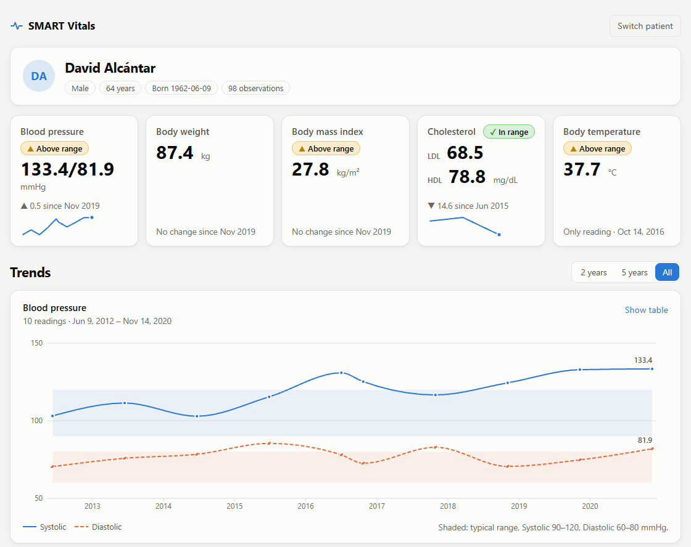

# SMART Vitals

A small [SMART on FHIR](https://hl7.org/fhir/smart-app-launch/) app that signs in through OAuth 2 and charts a patient's vitals and lab results over time. It runs against the public [SMART App Launcher sandbox](https://launch.smarthealthit.org/), which serves synthetic patients (no real PHI).

**Stack:** React + Vite, [`fhirclient`](https://github.com/smart-on-fhir/client-js) (SMART client), Recharts, Node/Express, Vitest.

<picture>
  <source media="(prefers-color-scheme: dark)" srcset="docs/screenshot-dark.png">
  
</picture>

*A synthetic patient from the SMART sandbox, in light and dark mode (it follows your system theme).*

## What it shows

- **Summary tiles** for the latest reading of each measure (blood pressure, weight, BMI, cholesterol, temperature, heart rate, glucose), with change since the previous reading, a sparkline, and an in/above/below-range flag (always an icon plus a label, never color alone).
- **Trend charts** with shaded typical ranges (dashed limit lines where ranges overlap), padded axes that do not exaggerate flat data, a crosshair tooltip, a label on the latest point, a table view, and a 2 year / 5 year / all time filter.
- Units are normalised (lb to kg, °F to °C), entered-in-error observations are skipped, and measures a patient has no data for are listed as chips instead of empty charts. A measure with a single reading shows as a tile only.

Typical ranges are general adult guidance for illustration, not medical advice.

## How the SMART launch works

1. The launcher opens `/launch?iss=<fhir-base>&launch=<token>` (EHR launch). The app reads the server's `.well-known/smart-configuration` and redirects to its authorize endpoint (`FHIR.oauth2.authorize` in `client/src/App.jsx`).
2. After the user approves, the auth server redirects back to `/` with a `code`. This is the authorization-code flow with PKCE, as a public client with no secret.
3. `FHIR.oauth2.ready()` exchanges the code for an access token and the in-context patient id. The app then reads `Patient` and `Observation?category=vital-signs,laboratory` (paged) with that token.
4. `client/src/fhirData.js` turns the Observations into chart series. It is pure code and unit tested.

Scopes: `launch patient/Patient.read patient/Observation.read openid fhirUser`. The standalone button uses `launch/patient` instead, so the sandbox shows a patient picker.

## Run it

```bash
npm install
npm run dev        # Vite on http://localhost:3000, with hot reload
```

Production-style (Express serves the built client):

```bash
npm start          # builds, then serves on http://localhost:3000 (PORT to override)
```

Then either:

- click **Connect to SMART sandbox** on the home page (standalone launch), or
- open the [SMART App Launcher](https://launch.smarthealthit.org/), choose a patient and set **App Launch URL** to `http://localhost:3000/launch` (EHR launch).

```bash
npm test           # unit tests for the FHIR to chart mapping
```

## Layout

```
client/   React app (App.jsx = OAuth flow, VitalChart.jsx = chart, fhirData.js = mapping)
server/   Express: serves client/dist and a /health route
```

## Notes and next steps

- The sandbox needs a `launch` parameter even on standalone launches, so the app sends `launch=e30` (base64 for `{}`) to the sandbox only.
- Public client by design. The sandbox accepts any `client_id`; a real EHR would need the app registered, with its redirect URI.
- Tokens live in `sessionStorage` (managed by `fhirclient`) and are never sent to the Node server.
- Ideas: reference-range bands, BMI from height and weight, SMART v2 scopes, and a confidential-client variant where the Node server holds the secret.
